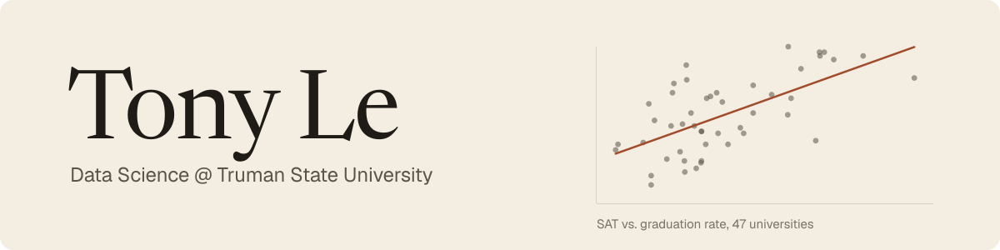

  <picture>
    <source media="(prefers-color-scheme: dark)" srcset="assets/header-dark.svg">
    
  </picture>

I'm a Data Science sophomore with a Math minor at Truman State University, GPA **3.73**. I work on data analytics, statistical modeling and machine learning, and I'm looking for Data Analyst, Data Engineer and Data Scientist internships.

  
  
  

### Selected work

| Project | What it does | Stack |
|:--|:--|:--|
| [RoofWatt](https://github.com/DungLe-304/roofwatt) | AI agent that ranks 171 Houston office rooftops by solar payback and drafts a pitch to the top owner. Built in 36 hours with Khoa Nguyen at HackPrinceton Fall 2026. [Live demo](https://roofwatt.streamlit.app) | Python, LangChain deepagents, Gemini/Ollama, Streamlit, pydeck, NREL PVWatts |
| [Walmart Sales Analytics Dashboard](https://github.com/DungLe-304/walmart-sales-analytics) | MySQL pipeline and interactive Chart.js dashboard on 1,000 transactions, live on [GitHub Pages](https://dungle-304.github.io/walmart-sales-analytics/walmart_dashboard.html). | MySQL, JavaScript, Chart.js |
| [SAT & Graduation Rate Analysis](https://github.com/DungLe-304/graduation-rates-sat-analysis) | OLS regression and ANCOVA with interaction terms on 47 universities. | Python, pandas, statsmodels, SQL |
| [SyncShift](https://github.com/DungLe-304/TruHacks2026-Business) | AI shift scheduling for campus workers. 3rd place, Business Category, TruHacks x Boeing 2026. | Product pitch, HTML prototype |

### Experience

| Role | Where | What I did |
|:--|:--|:--|
| Data Analyst Intern, AI/Callbot team | VinSmart Future (Vingroup), Ho Chi Minh City, May 2026 – August 2026 | Benchmarked two ASR models (Gipformer and Gemini) by WER on **46** hand-labeled call recordings and shipped an HTML dashboard. Traced Gemini's foreign-language output to its online vs. offline running mode; audio noise was not the cause. Built a binary classifier that labels audio/transcript pairs as usable or unusable for ASR training. |
| Vice President | American Statistical Association, Truman State chapter | Run hands-on workshops on data cleaning (R tidyverse, Python pandas) and statistical modeling. |
| Grader / Teaching Assistant, CS 180 (Java I) | Truman State | Grade Java assignments and answer questions in lab hours. |
| Mathematics Tutor | Truman State | Tutor 40+ students in Precalculus through Calculus II. |
| Chair of Finance | Community of College Entrepreneurs (CCE) | Keep the chapter's income and expense records and turn them into budget reports and funding requests. |

### Recognition

- 3rd Place, Business Category, TruHacks x Boeing 2026
- Finalist, Bulldog BITE 2026
- Emerging AI Engineer, CodePath AI201: Applications of AI Engineering

### Toolkit

  
  
  
  
  
  

### Activity

<picture>
  <source media="(prefers-color-scheme: dark)" srcset="https://streak-stats.demolab.com?user=DungLe-304&disable_animations=true&hide_border=true&background=201B17&stroke=3E352D&ring=E69A70&fire=E69A70&currStreakNum=F3ECE2&sideNums=F3ECE2&currStreakLabel=E69A70&sideLabels=BDB1A1&dates=BDB1A1">
  
</picture>
<picture>
  <source media="(prefers-color-scheme: dark)" srcset="https://github-readme-stats.vercel.app/api/top-langs/?username=DungLe-304&disable_animations=true&layout=compact&hide=html&langs_count=6&bg_color=201B17&title_color=E69A70&text_color=F3ECE2&hide_border=true">
  
</picture>

---

Currently: learning Transformer, CNN, RNN and diffusion architectures.
